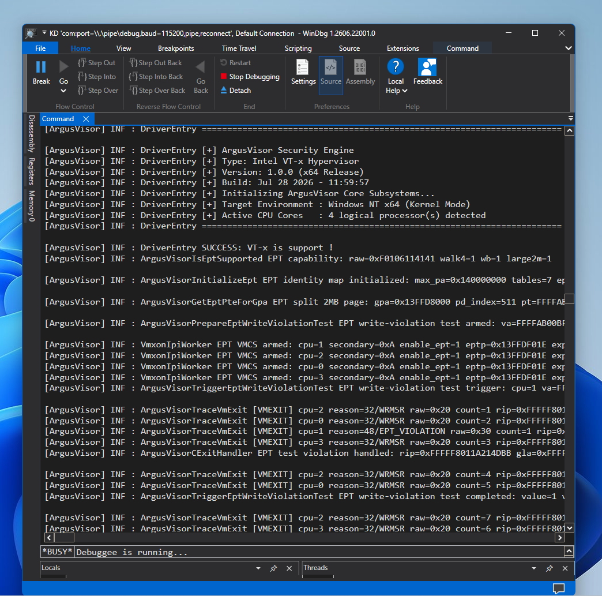

# ArgusVisor

> ArgusVisor is a research-oriented mini security hypervisor for Windows x64.

---

## Overview

ArgusVisor is an educational Intel VT-x hypervisor designed to help security researchers, reverse engineers, and systems programmers understand how modern hardware virtualization actually works.

---
# PoC

---
Unlike many hypervisor tutorials that focus only on implementation, ArgusVisor emphasizes **understanding the architecture** behind Intel VT-x.

The project demonstrates:

- VMX Root / Non-root Operation
- VMCS lifecycle
- VM Entry / VM Exit
- CPUID interception
- MSR interception
- VMCALL-based unload
- Extended Page Tables (EPT)
- Dynamic EPT permission management

The objective is not to build another production hypervisor, but to create a readable research platform that exposes the internal mechanisms used by modern virtualization-based security technologies.

---

# Current Features

- Intel VT-x capability detection
- VMXON initialization
- VMCS initialization
- VMCS per logical processor
- Multi-core virtualization
- VM Entry / VM Resume
- CPUID interception
- RDMSR / WRMSR interception
- CR Access interception
- XSETBV interception
- VMCALL hypercalls
- EPT Identity Mapping
- 2 MB → 4 KB EPT splitting
- Dynamic EPT permission updates
- INVEPT support
- DebugView tracing

---

# Roadmap

## Completed

- VMXON
- VMCS
- VMLAUNCH
- VMRESUME
- VM Exit dispatcher
- CPUID interception
- MSR interception
- EPT Identity Mapping

## Planned

- Monitor Trap Flag
- VPID
- INVVPID
- EPT Hooking
- Hypervisor Introspection API
- Memory Cloaking
- Nested Virtualization

---

# Research Vision

ArgusVisor serves as the experimental platform for studying:

- Hypervisor-based EDRs
- Memory introspection
- Kernel integrity monitoring
- EPT-based detection
- Anti-rootkit techniques
- Hardware-assisted security

---
